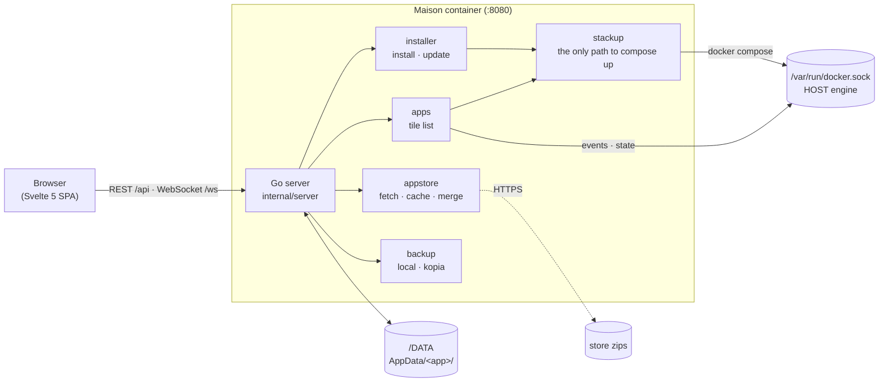

<p align="center">
  <picture>
    <source media="(prefers-color-scheme: dark)" srcset="docs/brand/maison-logo-horizontal-inverse.svg">
    
  </picture>
</p>

# Maison

**A home screen for your self-hosted apps, and a store to install more.**

Maison is a lightweight dashboard for running Docker apps on a single host. It looks and
feels like [CasaOS](https://casaos.io) and installs from the **same app-store format**,
but it does only two things: an app grid, and a store to install apps from. There is no
file manager, no user accounts, and no disk tooling.

It ships as **one container**: a Go binary with the Svelte UI built in, driving the host
Docker engine through the mounted socket. It has no database. The folders on disk and
the Docker daemon *are* its state, so every app it installs is a plain Compose project
you can still run by hand.

[Install on Unraid](https://ca.unraid.net/apps/maison-1v9cr880ceymo4?q=maison) ·
[Image: `ghcr.io/yundera/maison`](https://github.com/orgs/Yundera/packages/container/package/maison) ·
[Default app store](https://github.com/Yundera/AppStore) ·
[Documentation](#documentation) ·
MIT licensed

---

## Contents

- [Features](#features)
- [Getting started](#getting-started)
- [Configuration](#configuration)
- [Using Maison](#using-maison)
- [App stores](#app-stores)
- [How it works](#how-it-works)
- [Documentation](#documentation)
- [Maison vs CasaOS](#maison-vs-casaos)
- [Development](#development)

---

## Features

- **CasaOS-style home screen.** A clock, CPU/RAM and storage widgets, and a drag-to-reorder
  app grid with live status. Wallpapers. Four languages: English, French, German, Chinese.
- **App store, CasaOS format.** Reads CasaOS store zips as they are, from as many stores as
  you like. Browse, search, install, update, and share deep links to a single app.
- **Your changes survive updates.** Maison copies the store's `docker-compose.yml`
  unmodified and never edits it. Port, env and volume changes go into a
  `docker-compose.override.yml` next to it, so an update replaces the base file and keeps
  your changes.
- **Finds apps it didn't install.** Any Compose stack on the host that carries
  `x-compose-app` (or CasaOS `x-casaos`) metadata appears as a tile, marked *unmanaged*.
- **Updates.** One page lists every app with an update and can update them all. Each app is
  backed up first and rolled back if its update fails.
- **Backups.** Per-app archives on the same disk (`local`), or nightly off-box backups of
  apps *and* your files with [kopia](https://kopia.io), with retention. Restore one app, or
  restore your files into a new folder or over the live tree.
- **Uninstall keeps your data.** The app folder is moved into the archive tree, not deleted,
  so a restore brings it back.
- **Resources.** Live CPU, network, disk and per-app usage, 30 days of history, and disk /
  network benchmarks.
- **Notifications.** Failed backups and other incidents can be sent by email over SMTP.
- **Routing.** Reach apps on published ports (the default with no domain), on your
  domains through a reverse proxy, or through your own router — the same app listing
  either way. See [`docs/routing.md`](./docs/routing.md).
- **Installable as a PWA** from *Settings → This device*.

## Getting started

### Before you install

- A Linux host with **Docker Engine** and the **Compose plugin** (`docker compose version`).
  Maison is published for **amd64** and **arm64**.
- A **data folder** on the host. Maison and every app it installs keep their files there.
  This guide uses `/DATA`. Any absolute path works.
- A **trusted network**. Maison has **no login screen**. It is meant to sit on your LAN,
  behind a VPN, or behind a proxy that does authentication. **Never publish its port to the
  internet.** Maison also holds the Docker socket, which gives the same access as root on
  the host.

### Option A: Docker Compose (any Linux host)

Create a folder for the stack and save this as `docker-compose.yml`:

```yaml
services:
  maison:
    image: ghcr.io/yundera/maison:1            # major-version tag; :latest also exists
    container_name: maison
    restart: unless-stopped
    ports:
      - "8080:8080"
    environment:
      DATA_ROOT: /DATA                         # where the data folder is mounted inside the container
      DATA_HOST_PATH: /DATA                    # the same folder on the HOST; must equal `source` below
      PUID: "1000"                             # owner applied to app folders
      PGID: "1000"
      TZ: Europe/Paris
      HOST_PROC: /host/proc                    # optional: host-accurate Resources page
    group_add:
      - "999"                                  # group of /var/run/docker.sock: stat -c '%g' /var/run/docker.sock
    networks:
      - mesh
    volumes:
      - type: bind
        source: /DATA                          # MUST equal DATA_HOST_PATH
        target: /DATA
        bind:
          propagation: rshared
      - /var/run/docker.sock:/var/run/docker.sock
      - /proc:/host/proc:ro

networks:
  mesh:                                        # the network apps join (see .env.app below)
    name: mesh
    driver: bridge
```

Then:

```bash
sudo mkdir -p /DATA
stat -c '%g' /var/run/docker.sock     # put this number under group_add
docker compose up -d
```

Open **http://\<host-ip\>:8080**.

> **Why two paths?** Maison runs inside a container, but the apps it installs are started by
> the **host** Docker daemon. The host resolves their bind mounts on the host, not inside
> Maison's container. `DATA_HOST_PATH` tells Maison where the data folder really is, so
> every app's volumes point to the right place. If it doesn't match the bind `source`, the
> apps' data ends up in a different directory from the one you think. Use a **host bind
> mount**, not a named volume. When the two paths differ, Maison also makes the host path
> resolve inside its own container (a link to `/DATA`), so an app's scripts can use one
> spelling for both their shell and their `docker run -v`.

To build from source instead, clone this repo, then
`cp .env.example .env && docker compose up -d --build`. The repo's
[`docker-compose.yml`](./docker-compose.yml) is the same stack, set up through `.env`.

### Option B: Unraid

Maison is in **Community Applications**:
**[Maison on Unraid](https://ca.unraid.net/apps/maison-1v9cr880ceymo4?q=maison)**.

1. In **Apps**, search for **Maison** and click **Install**. The template defaults are fine.
   The data folder is `/mnt/user/appdata/maison` and `DATA_HOST_PATH` already matches it.
   Change both together, or neither.
2. **Create the app network once.** The template runs Maison on Unraid's bridge, which
   doesn't create the `mesh` network that installed apps join by default. In the Unraid
   terminal, run:
   ```bash
   docker network create mesh
   ```
   If you skip this, installs fail with *network mesh declared as external, but could not be
   found*.
3. Open the WebUI on port **8080**.

### First steps

1. **Check `.env.app`.** On first boot Maison creates
   `<data folder>/AppData/maison/.env.app`. This file holds the variables that every app
   receives: the network, your domain, and a default admin password. **Change
   `APP_DEFAULT_PASSWORD`** before you install anything you will expose. It ships as the
   same placeholder on every install. You can edit the file in *Settings → App
   environment*. Changes take effect the next time each app starts — except the
   password, which only applies to apps installed afterwards. Details are in
   [`docs/app-env.md`](./docs/app-env.md).

   That shared password is legacy and being phased out. Up-to-date store apps generate
   their own password per app instead, and Maison shows it to you the first time you
   open the app (see [Credentials](./docs/x-compose-app.md#credentials)).
2. **Install an app.** Open the **App Store** tile, pick an app, and click **Install**. The
   tile shows two progress bars, one for the image download and one for the stack start.
3. **Open it.** Read the next section first.

### Opening your apps: the one thing to know

An app that declares [`routes`](./docs/x-compose-app.md#routes) is reached the way
**Settings › Routing** says — with no domain configured, that is a port published on this
machine, opened at `http://<the host you opened Maison on>:<port>`. See
[`docs/routing.md`](./docs/routing.md).

An app that still routes itself opens whichever address it declares:

| The app declares… | It opens at… | What you need |
|---|---|---|
| a port and no host (`webui-port`, or `port_map` in `x-casaos`), or a published host port | `http://<the host you opened Maison on>:<port>` | nothing |
| a domain route (`webui-host: myapp-${domain}`) | `https://myapp-<APP_DOMAIN>` | `APP_DOMAIN` set in `.env.app`, **and** a reverse proxy that routes it |

Apps in today's [Yundera store](https://github.com/Yundera/AppStore) use the second
kind. They publish no ports. A [Caddy](https://caddyserver.com) router finds them by their
`caddy_*` labels on the app network. On a plain install with no domain, these apps install
and run, but the tile shows **"no reachable address"**. To make them open, either:

- **put a reverse proxy on the `mesh` network.** Use one that reads `caddy_*` labels, such
  as [caddy-docker-proxy](https://github.com/lucaslorentz/caddy-docker-proxy). Then set
  `APP_DOMAIN` (and the `APP_PUBLIC_IP*` values) in `.env.app`. [`dev/`](./dev/README.md)
  is a working example: Maison, Caddy, and a Dex login provider wired together, served
  locally on `app.localhost`. Or
- **run it on a [Yundera PCS](https://yundera.com)**, where the domain, proxy, TLS and
  login are already in place.

### Troubleshooting

| Symptom | Cause / fix |
|---|---|
| Dashboard loads, installs fail with *permission denied* on `docker.sock` | `group_add` doesn't match the socket's group. Use `stat -c '%g' /var/run/docker.sock`. |
| *network mesh declared as external, but could not be found* | Create it (`docker network create mesh`) or set `APP_NET` in `.env.app` to a network that exists. |
| App data is not where you expected on the host | `DATA_HOST_PATH` ≠ the bind `source`. Make them equal. |
| Tile says **no reachable address** | The app is routed by domain. See [Opening your apps](#opening-your-apps-the-one-thing-to-know). |
| An app's install fails with *password is too short* | Set `APP_DEFAULT_PASSWORD` in `.env.app` to 12+ characters. |
| Health check | `GET /ping` returns `200`. |

---

## Configuration

Maison keeps two sets of settings apart: the variables **Maison itself needs to run**, and
the variables **apps receive**.

### Maison's environment

| Var | Default | Purpose |
|-----|---------|---------|
| `DATA_ROOT` | `/DATA` | The data folder's path **inside** the container. |
| `DATA_HOST_PATH` | = `DATA_ROOT` | The same folder's path **on the host**. Must equal the bind `source`. When it differs from `DATA_ROOT`, Maison links it to `DATA_ROOT` inside its container at startup, so app scripts can use the host spelling everywhere. |
| `APPSTORE_URL` | Yundera AppStore zip | Store zip URL(s), comma-separated. The boot default for the store list; a deployment adds its store with `maison stores ensure` instead. |
| `PUID` / `PGID` | `1000` / `1000` | Owner applied to app folders, and passed to apps. |
| `TZ` | (none) | Timezone for the dashboard and the apps. |
| `HTTP_ADDR` | `:8080` | Listen address. |
| `HOST_PROC` | (none) | Where the host's `/proc` is mounted (e.g. `/host/proc`). With it, the Resources page shows the host's network, processes and mounts, not the container's. |
| `STATE_DIR` | `${DATA_ROOT}/AppData/maison` | Where Maison keeps everything it owns. |
| `SHARED_DIR` | `${DATA_ROOT}/AppDataShared` | State that belongs to the deployment, not to any one app. |
| `ADMIN_SOCKET` | `/run/maison/admin.sock` | The container-local socket the `maison` CLI talks to. See [`docs/config.md`](./docs/config.md). |
| `SMTP_HOST` `SMTP_PORT` `SMTP_USER` `SMTP_PASS` `SMTP_FROM` `SMTP_TO` `SMTP_SECURITY` | (none) | *Transition.* Default mail transport while the `smtp` setting is not managed. A deployment now manages it with `maison settings set smtp`. See [`docs/config.md`](./docs/config.md). |
| `FEEDBACK_URL` / `FEEDBACK_TOKEN` | (none) | *Transition.* Where *Send feedback* goes while no `feedback` setting exists. See [`docs/feedback.md`](./docs/feedback.md). |

Everything else Maison does is configured in `settings.json`, some of it managed by the
deployment through the `maison` CLI: see [`docs/config.md`](./docs/config.md).

The repo's compose also reads `HOST_PORT` (published port) and `DOCKER_GID` from `.env`.

### What apps receive: `.env.app`

`${STATE_DIR}/.env.app` belongs to the deployment. Maison creates it once with documented
defaults and never overwrites it. On every install and every start, Maison copies its keys
into the app's own `.env`, together with the variables it computes per app (`AppID`,
`PUID`, `PGID`, `TZ`, `DATA_ROOT`). Store apps refer to these only as `${VAR}` in their
compose, so running `docker compose up -d` by hand in the app folder does exactly what
Maison does.

| Key | Default | Meaning |
|-----|---------|---------|
| `APP_NET` | `mesh` | External network each app's main service joins. It must already exist. |
| `APP_DOMAIN` | (empty) | Base domain apps are routed on (`myapp-${APP_DOMAIN}`). |
| `APP_PUBLIC_IP*` | (empty) | Public IP(s), for routing domains templated on the address (`{name}-${APP_PUBLIC_IP_DASH}.sslip.io`). |
| `APP_EMAIL`, `APP_DEFAULT_PASSWORD` | (empty), `changeme-please` | Seeded into apps that create an admin account on first boot; an installed app keeps the password it got. **Change the password.** Legacy: one password shared by every app, replaced by per-app [`secrets`](./docs/x-compose-app.md#secrets-and-variables) and [`credentials`](./docs/x-compose-app.md#credentials). |

Full reference: [`docs/app-env.md`](./docs/app-env.md).

### On disk

```
<data folder>/
├── AppData/
│   ├── <app>/                     one folder per installed app
│   │   ├── docker-compose.yml     the store's file, byte-for-byte, never edited
│   │   ├── docker-compose.override.yml   your edits + where the app came from (store-ref)
│   │   ├── .env                   variables from .env.app + per-app ones
│   │   └── …                      the app's data
│   └── maison/                    Maison's own state (STATE_DIR)
│       ├── .env.app
│       ├── .backups/<app>/<stamp> archives: on-demand backups and uninstalls
│       └── …                      settings, store cache, resource history
└── AppDataShared/                 deployment-wide state (SHARED_DIR)
```

Maison has no app registry. The folders under `AppData/` define which apps exist, and
Docker reports how each one is doing. See [`docs/app-model.md`](./docs/app-model.md).

---

## Using Maison

```
┌─────────────────────────────────────────────────────────────────────────┐
│  Maison                                                 [ settings ▾ ]  │
├────────────────────┬────────────────────────────────────────────────────┤
│  12:28             │  App ▾                                       [ + ] │
│  Thu, 9 Jul        │                                                    │
│                    │   ┌──────┐   ┌──────┐   ┌──────┐   ┌──────┐        │
│  System status     │   │ App  │   │ Jelly│   │ Next │   │ Photo│        │
│  ◔ 12% CPU         │   │ Store│   │  fin │   │ cloud│   │ prism│        │
│  ◑  9% RAM         │   └──────┘   └──────┘   └──────┘   └──────┘        │
│                    │   ┌──────┐   ┌──────┐                              │
│  Storage           │   │ Gitea│   │ Grafa│*   * unmanaged: found on     │
│  12.9 / 386 GB     │   │      │   │  na  │      the host, not installed │
│  ▓▓░░░░░░░░░░      │   └──────┘   └──────┘      by Maison               │
│                    │                                                    │
│  Widget settings › │                                                    │
└────────────────────┴────────────────────────────────────────────────────┘
```

**Tiles.** Each tile has a status dot driven by the container's health check. Hover a tile
for **Open** and a ⋯ menu: Settings, Restart, Stop / Start, Uninstall. A tile is greyed out
when the app is stopped, shows `…` while an action is running, and shows two progress bars
during an install. If you open an app that is stopped or still starting, Maison first
starts it and shows a status page until the app answers.

**App / Services / System.** When the box has them, the grid heading turns into a switch:

- **Services** are apps with no web UI, such as Samba or a database. They are sorted there
  automatically, and their tile opens Settings.
- **System** apps are the platform's own pieces. They declare `view: system`.
- An app can also mark itself as not stoppable or not uninstallable. Maison then hides
  those menu entries, and the API refuses those actions.

**`+` menu.** Adds a bookmark tile that links to any URL.

**App settings.** Each app has a config window (ports, env, volumes, web-UI address) plus
tabs for **logs**, **stats**, **backups** and **update source**. You can point an app at a
different store from its Update tab.

**Settings.** The top-bar menu holds wallpaper, language, widgets and *Send feedback*. The
full settings page (`/settings/<section>`) has these sections:

| Section | What it does |
|---|---|
| Routing | How apps are reached: published ports, domains through a reverse proxy, or an external router ([`docs/routing.md`](./docs/routing.md)) |
| App environment | Edit `.env.app` |
| App stores | Add or remove store sources |
| Updates | Every app that needs an update or attention, and an **Update all** button |
| Backups | Engine and schedule; browse and restore every backup, including backups of uninstalled apps ([`docs/backup.md`](./docs/backup.md)) |
| Resources | Live and 30-day CPU / network / disk / per-app usage, benchmarks, containers no app accounts for ([`docs/resources.md`](./docs/resources.md)) |
| Notifications | Mail transport, recipients, the incident list ([`docs/incidents.md`](./docs/incidents.md)) |
| This device | Install as an app (PWA); settings for this browser only |

---

## App stores

A store is a **zip of Compose apps served over HTTP**, in the
[CasaOS App Store](https://github.com/IceWhaleTech/CasaOS-AppStore) layout. Every app is a
`docker-compose.yml` with an `x-compose-app` block — Maison's definition of an app: title,
icon, category, screenshots, web-UI address, data folders, secrets, setup steps, views,
backup exclusions. Any host that serves a zip works. Nothing in Maison is tied to one forge.

- **Several stores:** set `APPSTORE_URL` to a comma-separated list, or add stores in
  *Settings → App stores*. Catalogs are cached under `${STATE_DIR}/appstore` and refreshed
  at boot, every night, and when you press ⟳.
- **`x-compose-app`:** the spec, for store authors:
  [`docs/x-compose-app.md`](./docs/x-compose-app.md).
- **CasaOS stores:** an app with no `x-compose-app` is read from its CasaOS `x-casaos`
  block, translated whole. The two are never mixed: beside an `x-compose-app` block,
  `x-casaos` is ignored.
- **`store.json`** (optional, at the store root) gives the store a display name:
  `{ "name": "Yundera App Store" }`. A store without one is listed by its URL.

### Deep links

A **store reference** points to one app in one store, and `/store/…` URLs carry it:

```
/store/<zip URL without https://>/-/<apps folder>/<app>
/store/github.com/Yundera/AppStore/archive/refs/heads/main.zip/-/Apps/FileBrowser
```

Maison splits on the **last** `/-/`, so GitLab archive URLs, which contain one, also work.
The store does **not** need to be configured on the box: the page warns you before you
install from a store you haven't added. A link only shows the app. Installing always takes
a click, so a pasted URL can never install software on a box. `/store/<app>` alone looks
the app up in the merged catalog. The grammar is defined in `internal/appstore/ref.go`
(the reference) and copied in `web/src/lib/storeref.ts`.

---

## How it works



**The one rule.** Every `docker compose up` (install, start, update, saving an app's
config) goes through `internal/stackup`:

```
folders → secrets → variables → setup steps → seed → files → docker compose up -d --remove-orphans → started steps
```

If you call `composecmd.Up` directly, the app starts without its declared folders, and the
bug only shows up on someone's *second* boot. Full sequences and failure semantics:
[`docs/lifecycle.md`](./docs/lifecycle.md).

**Live updates.** One multiplexed WebSocket carries system stats, app status, logs and
install progress. Container events and lifecycle changes re-send the app list, so tiles
update on their own. Each channel is only sampled while someone is subscribed to it.

| Package | Role |
|---|---|
| `internal/server` | chi router: REST `/api`, WebSocket `/ws`, the SPA. Also routes by `Host:`: a request for a stopped app's domain gets the **launch page** instead of the dashboard. |
| `internal/apps` | The tile list. Matches app folders on disk against live Docker state and finds unmanaged stacks carrying app metadata. |
| `internal/appstore` | Fetches, caches and merges store zips. Store references. |
| `internal/installer` | Install and update, with two-track progress. |
| `internal/stackup` · `composecmd` | The single path to `docker compose up` · the compose CLI wrapper. |
| `internal/dockerx` | Docker Engine API: discovery, lifecycle, event stream. |
| `internal/appenv` · `envinject` | `.env.app`, and the variables written into each app's `.env`. |
| `internal/xcasaos` · `xcomposeapp` | The two compose extensions. |
| `internal/backup` · `engine` | Backup sets and the pluggable engines (`local`, `kopia`). |
| `internal/incident` · `notify` | Incident register and mail notifications. |
| `internal/metrics` · `bench` | Resource history ring file · disk / network benchmarks. |
| `internal/live` | WebSocket hub. |
| `web/` | Svelte 5 + Vite. Builds into `internal/ui/dist`, which the Go binary embeds. |

---

## Documentation

This README is the overview. The files in `docs/` are **authoritative** and take
precedence if anything here disagrees with them.

| Doc | What it covers |
|-----|----------------|
| [`app-model.md`](./docs/app-model.md) | Where an app lives on disk and how its tile state is derived. **Start here.** |
| [`lifecycle.md`](./docs/lifecycle.md) | What install / start / update / save / uninstall / backup / restore do, in order, and how they fail. |
| [`app-env.md`](./docs/app-env.md) | `.env.app`: what an app receives, and how it reaches the app's `.env`. |
| [`x-compose-app.md`](./docs/x-compose-app.md) | Maison's compose extension: web-UI URL, folders, steps and the script entry, views, lifecycle, backup exclusions. |
| [`routing.md`](./docs/routing.md) | The routing setting: ports, proxy labels on your domains, or an external router — and the address each app is told it has. |
| [`backup.md`](./docs/backup.md) | Backup and recovery: the two backup sets, engines, schedule, retention, encryption. Mostly implemented; the status note at the top lists the gaps. |
| [`incidents.md`](./docs/incidents.md) | Incident register and notifications. |
| [`resources.md`](./docs/resources.md) | The Resources page, its history file, the `HOST_PROC` mount, benchmarks. |
| [`feedback.md`](./docs/feedback.md) | *Send feedback* and the sink contract. |
| [`FEATURE-COMPARISON.md`](./docs/FEATURE-COMPARISON.md) | Row-by-row scope compared with CasaOS. |
| [`dev/README.md`](./dev/README.md) | The local stack with Caddy and SSO. |

---

## Maison vs CasaOS

Maison is **not** a CasaOS fork and shares no code with it. It copies the CasaOS home-screen
UX and is compatible with its **store format**, and nothing else. CasaOS plugins won't
work.

| | CasaOS | Maison |
|---|:-:|:-:|
| App-grid dashboard, widgets, i18n | ✅ | ✅ |
| Store: multi-store, install, update | ✅ | ✅ |
| Apps it didn't install show up as tiles | ❌ (manual import form) | ✅ automatic |
| Edits survive app updates | ❌ (rewrites the compose) | ✅ override file |
| Off-box backups, update rollback | ❌ | ✅ |
| Resource history, benchmarks, notifications | ❌ | ✅ |
| On-disk layout | `AppData/casaos/apps/<app>` | flat `AppData/<app>` |
| Login / users | ✅ | ❌ (put it behind your own auth) |
| File manager, disk/RAID, Samba, remote storage | ✅ | ❌ |

Full table: [`docs/FEATURE-COMPARISON.md`](./docs/FEATURE-COMPARISON.md).

---

## Development

You need Go (version in `go.mod`) and Node.js (LTS).

```bash
# UI first: Vite builds into internal/ui/dist, which go:embed bakes into the binary
npm --prefix web install
npm --prefix web run build
npm --prefix web run check     # svelte-check

# Backend (serves the embedded UI on :8080)
go run ./cmd/maison
go test ./...

# UI hot reload: Vite on :5173, proxies /api, /ping and /ws to :8080
npm --prefix web run dev
```

A placeholder `internal/ui/dist/index.html` is committed so `go build` works before the UI
is built. Run the Vite build to get the real UI. If Go or Node isn't installed, build in
containers:

```bash
docker run --rm -v "$PWD/web":/src -w /src node:22 sh -c 'npm install && npm run build'
docker run --rm -v "$PWD":/src -w /src golang:1.26 go test ./...
```

**Store apps with SSO** need a Caddy router and a Dex OIDC provider. The root compose
doesn't have them. [`dev/`](./dev/README.md) adds both, wired the way a Yundera PCS wires
them:

```bash
cd dev
cp .env.dev.example .env.dev   # set DOCKER_GID + DATA_HOST_PATH
./gen-certs.sh                 # once
docker compose --env-file .env.dev up -d --build
```

**Releases.** A GitHub Action publishes `ghcr.io/yundera/maison` for amd64 and arm64:
`:main` on every push to `main`; `:X.Y.Z`, `:X.Y`, `:X` and `:latest` on `vX.Y.Z` tags.
To release, push a tag. There is no version file to edit.

## License

[MIT](./LICENSE)
